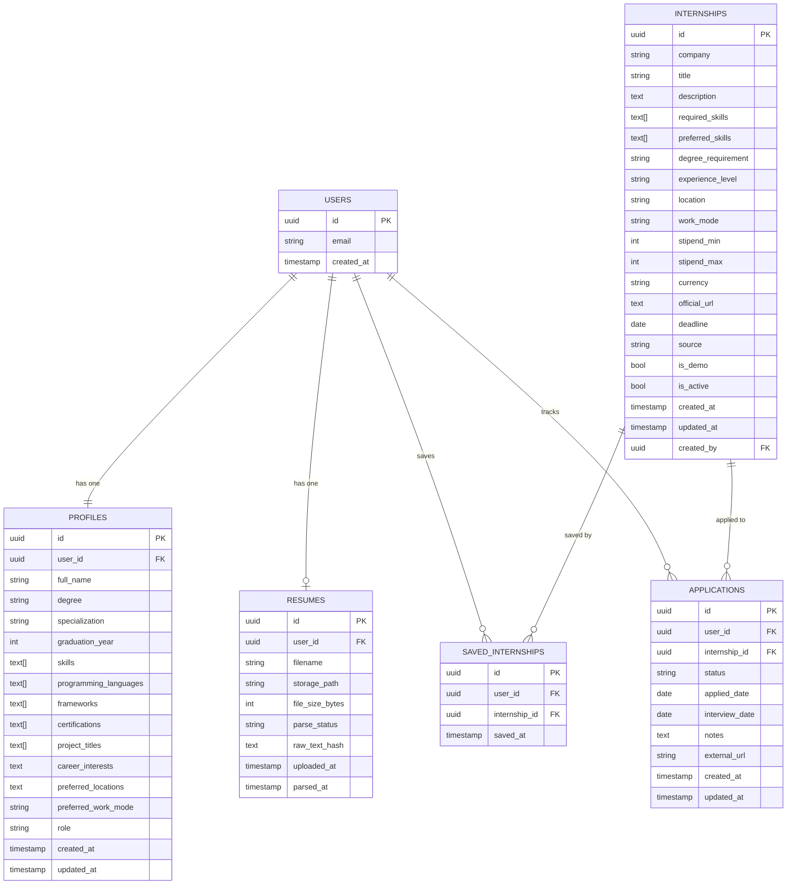

# DATABASE.md — Data Model
# Internship Tracker AI

---

## 1. ER Diagram



---

## 2. Table Definitions

### profiles
```sql
CREATE TABLE profiles (
  id              UUID PRIMARY KEY DEFAULT gen_random_uuid(),
  user_id         UUID NOT NULL UNIQUE REFERENCES auth.users(id) ON DELETE CASCADE,
  full_name       TEXT,
  degree          TEXT,
  specialization  TEXT,
  graduation_year SMALLINT,
  skills          TEXT[] DEFAULT '{}',
  programming_languages TEXT[] DEFAULT '{}',
  frameworks      TEXT[] DEFAULT '{}',
  certifications  TEXT[] DEFAULT '{}',
  project_titles  TEXT[] DEFAULT '{}',
  career_interests TEXT,
  preferred_locations TEXT,
  preferred_work_mode TEXT DEFAULT 'any',
  role            TEXT NOT NULL DEFAULT 'student' CHECK (role IN ('student', 'admin')),
  created_at      TIMESTAMPTZ NOT NULL DEFAULT NOW(),
  updated_at      TIMESTAMPTZ NOT NULL DEFAULT NOW()
);
CREATE INDEX idx_profiles_user_id ON profiles(user_id);
```

### resumes
```sql
CREATE TABLE resumes (
  id              UUID PRIMARY KEY DEFAULT gen_random_uuid(),
  user_id         UUID NOT NULL UNIQUE REFERENCES auth.users(id) ON DELETE CASCADE,
  filename        TEXT NOT NULL,
  storage_path    TEXT NOT NULL,
  file_size_bytes INTEGER NOT NULL,
  parse_status    TEXT NOT NULL DEFAULT 'pending'
                  CHECK (parse_status IN ('pending','parsed','failed','scanned')),
  raw_text_hash   TEXT,
  uploaded_at     TIMESTAMPTZ NOT NULL DEFAULT NOW(),
  parsed_at       TIMESTAMPTZ
);
CREATE INDEX idx_resumes_user_id ON resumes(user_id);
```
**Note:** storage_path points to Supabase Storage private bucket. Files never publicly accessible by default.

### internships
```sql
CREATE TABLE internships (
  id              UUID PRIMARY KEY DEFAULT gen_random_uuid(),
  company         TEXT NOT NULL,
  title           TEXT NOT NULL,
  description     TEXT NOT NULL,
  required_skills TEXT[] DEFAULT '{}',
  preferred_skills TEXT[] DEFAULT '{}',
  degree_requirement TEXT,
  experience_level TEXT DEFAULT 'entry',
  location        TEXT,
  work_mode       TEXT DEFAULT 'any' CHECK (work_mode IN ('remote','hybrid','onsite','any')),
  stipend_min     INTEGER,
  stipend_max     INTEGER,
  currency        TEXT DEFAULT 'INR',
  official_url    TEXT,
  deadline        DATE,
  source          TEXT DEFAULT 'manual',
  is_demo         BOOLEAN NOT NULL DEFAULT FALSE,
  is_active       BOOLEAN NOT NULL DEFAULT TRUE,
  created_at      TIMESTAMPTZ NOT NULL DEFAULT NOW(),
  updated_at      TIMESTAMPTZ NOT NULL DEFAULT NOW(),
  created_by      UUID REFERENCES auth.users(id)
);
CREATE INDEX idx_internships_deadline ON internships(deadline) WHERE is_active = TRUE;
CREATE INDEX idx_internships_is_demo ON internships(is_demo);
CREATE INDEX idx_internships_skills ON internships USING GIN (required_skills);
```

### saved_internships
```sql
CREATE TABLE saved_internships (
  id              UUID PRIMARY KEY DEFAULT gen_random_uuid(),
  user_id         UUID NOT NULL REFERENCES auth.users(id) ON DELETE CASCADE,
  internship_id   UUID NOT NULL REFERENCES internships(id) ON DELETE CASCADE,
  saved_at        TIMESTAMPTZ NOT NULL DEFAULT NOW(),
  UNIQUE (user_id, internship_id)
);
CREATE INDEX idx_saved_user_id ON saved_internships(user_id);
```

### applications
```sql
CREATE TABLE applications (
  id              UUID PRIMARY KEY DEFAULT gen_random_uuid(),
  user_id         UUID NOT NULL REFERENCES auth.users(id) ON DELETE CASCADE,
  internship_id   UUID REFERENCES internships(id) ON DELETE SET NULL,
  company_name    TEXT NOT NULL,
  role_title      TEXT NOT NULL,
  status          TEXT NOT NULL DEFAULT 'saved'
                  CHECK (status IN ('saved','applied','assessment','interview','selected','rejected')),
  applied_date    DATE,
  interview_date  DATE,
  deadline        DATE,
  notes           TEXT,
  external_url    TEXT,
  created_at      TIMESTAMPTZ NOT NULL DEFAULT NOW(),
  updated_at      TIMESTAMPTZ NOT NULL DEFAULT NOW()
);
CREATE INDEX idx_applications_user_id ON applications(user_id);
CREATE INDEX idx_applications_status ON applications(user_id, status);
CREATE INDEX idx_applications_deadline ON applications(user_id, deadline) WHERE deadline IS NOT NULL;
```

---

## 3. Row Level Security Policies

```sql
-- Enable RLS on all user-owned tables
ALTER TABLE profiles ENABLE ROW LEVEL SECURITY;
ALTER TABLE resumes ENABLE ROW LEVEL SECURITY;
ALTER TABLE saved_internships ENABLE ROW LEVEL SECURITY;
ALTER TABLE applications ENABLE ROW LEVEL SECURITY;

-- profiles: own row only
CREATE POLICY "profiles_own" ON profiles
  USING (user_id = auth.uid());

-- resumes: own row only
CREATE POLICY "resumes_own" ON resumes
  USING (user_id = auth.uid());

-- saved_internships: own rows only
CREATE POLICY "saved_own" ON saved_internships
  USING (user_id = auth.uid());

-- applications: own rows only
CREATE POLICY "applications_own" ON applications
  USING (user_id = auth.uid());

-- internships: readable by all authenticated users; writable by admin only
ALTER TABLE internships ENABLE ROW LEVEL SECURITY;
CREATE POLICY "internships_read" ON internships FOR SELECT
  USING (is_active = TRUE);
CREATE POLICY "internships_admin_write" ON internships FOR ALL
  USING (
    EXISTS (
      SELECT 1 FROM profiles
      WHERE profiles.user_id = auth.uid()
      AND profiles.role = 'admin'
    )
  );
```

---

## 4. Migration Strategy

- Migrations stored in `supabase/migrations/` as numbered SQL files
- Format: `NNN_description.sql`
- Applied in order: 001_initial_schema.sql, 002_seed_demo_data.sql, ...
- Never alter columns destructively in a migration; add nullable columns, migrate data, then drop old column in a separate migration
- All migrations tested against a local Supabase instance before applying to production

---

## 5. Demo Seed Strategy

`002_seed_demo_data.sql` inserts 20 clearly labeled internship listings with `is_demo = TRUE`.
Seed data covers: various companies, skills, locations, work modes, stipend ranges.
Seed is idempotent (uses INSERT ... ON CONFLICT DO NOTHING).

---

## 6. Sensitive Data Handling

| Data | Handling |
|---|---|
| Resume files | Private Supabase Storage; signed URLs with 15-min expiry |
| Raw resume text | Processed in memory; not stored in DB; only hash stored |
| Passwords | Managed by Supabase Auth (bcrypt) |
| JWT tokens | Short-lived (1h access token); stored in httpOnly cookies |
| AI API keys | Backend env vars only; never in frontend or DB |

---

## 7. Backup and Recovery

- Supabase provides daily automated backups on paid plans
- Point-in-time recovery available on Pro plan
- Resume files in Storage: versioning optional
- Migration files in Git serve as schema recovery source
