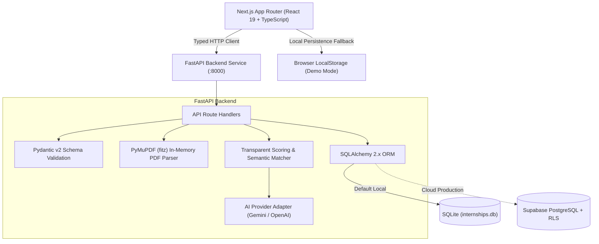

# 🚀 Internship Tracker AI
*AI-Powered Internship Discovery, Matching & Application Pipeline Management*

[](https://fastapi.tiangolo.com)
[](https://nextjs.org)
[](https://react.dev)
[](https://www.typescriptlang.org)
[](https://tailwindcss.com)
[](https://pymupdf.readthedocs.io)
[](https://supabase.com)

---

## 📌 Executive Summary

**Internship Tracker AI** is a production-minded web application designed to streamline the technical internship recruitment journey for university students. It solves candidate fragmentation across multiple hiring portals by unifying:
1. **Curated Opportunity Discovery:** Filter verified openings by work mode, deadline urgency, compensation, and required technical skills.
2. **AI Job Description Analyzer:** Deconstruct complex job postings into structured schemas (role, required skills, preferred tools, eligibility, compensation, responsibilities).
3. **Objective Resume–Job Matcher:** Benchmark candidate PDF resumes against job requirements using transparent, evidence-based scoring (70% required skills, 20% preferred skills, 10% academic/project baseline) rather than black-box claims.
4. **Interactive Kanban Pipeline:** Move applications seamlessly through 6 recruiting stages: *Saved*, *Applied*, *Assessment*, *Interview*, *Selected*, and *Rejected*.
5. **Urgency Deadline Management:** Chronological timeline tracking overdue, closing soon, and upcoming deadlines with days-remaining countdowns.
6. **Hugging Face Jobs Tabular Dataset Integration (`priyaagarwal19/Jobs-tabular-dataset`):** Ingestion and caching of 391 real-world sample listings and 1,600 synthetic records with scikit-learn TF-IDF vectorization, Cosine Similarity scoring, NLP skill extraction, and automated skill-gap recommendations.

---

## 🏛️ System Architecture



---

## 🎨 Visual Identity & Design Tokens

Crafted to deliver a commercial career-tech SaaS aesthetic:
- **Midnight Navy:** `#0B1020` (Application Background)
- **Dark Slate:** `#111827` (Card & Panel Surfaces)
- **Electric Blue:** `#4F7CFF` (Primary Brand & Navigation Accent)
- **Cyan Highlight:** `#35D5F2` (Metrics, Badges & Secondary Accents)
- **Pure White:** `#F8FAFC` (Headings & Primary Text)
- **Muted Slate:** `#94A3B8` (Descriptions & Secondary Meta)
- **Semantic Statuses:**
  - `Emerald (#10B981)`: Selected / Strong Match
  - `Amber (#F59E0B)`: Assessment / Due Soon (< 7 Days)
  - `Rose (#EF4444)`: Rejected / Overdue Deadlines

---

## ⚡ Quick Start Guide (Zero-Config Demo Mode)

The project is built with **zero external dependencies required to start**. It automatically runs in a fully functional Academic Demo Mode with rich seed records (Microsoft, NVIDIA, Stripe, Atlassian, Figma, Google DeepMind) and deterministic AI extraction engines.

### 1. Prerequisites
- **Node.js:** v18+ (tested on Node v24)
- **Python:** 3.10+ (tested on Python 3.13)

### 2. Backend Setup & Launch
```bash
# Navigate to backend
cd backend

# Create & activate Python virtual environment
python3 -m venv .venv
source .venv/bin/activate  # On Windows: .venv\Scripts\activate

# Install dependencies
pip install -r requirements.txt

# Launch FastAPI development server
uvicorn app.main:app --host 0.0.0.0 --port 8000 --reload
```
*The backend API documentation is now live at `http://localhost:8000/docs`.*

### 3. Frontend Setup & Launch
In a separate terminal window:
```bash
# Navigate to frontend
cd frontend

# Install packages
npm install

# Launch Next.js App Router
npm run dev
```
*Open [http://localhost:3000](http://localhost:3000) in your browser.*

---

## ☁️ Cloud & Live AI Configuration (Optional)

### Live AI Services (Gemini or OpenAI)
To enable live LLM synthesis rather than the built-in deterministic engine:
1. Open `backend/.env`
2. Add your API key:
```env
GEMINI_API_KEY=your_gemini_api_key_here
# or
OPENAI_API_KEY=your_openai_api_key_here
```
3. Restart the FastAPI server. The system automatically detects the live key and switches from `deterministic-fallback-v1` to live LLM extraction.

### Supabase PostgreSQL & Auth
1. Create a project at [supabase.com](https://supabase.com).
2. Run the migration script located at `supabase/migrations/001_initial_schema.sql` in the Supabase SQL Editor.
3. Configure `backend/.env`:
```env
DATABASE_URL=postgresql://postgres:[PASSWORD]@[HOST]:5432/postgres
SUPABASE_URL=https://your-project.supabase.co
SUPABASE_ANON_KEY=your-anon-key
```

---

## 🧪 Testing & Verification

### Backend Automated Test Suite
The backend includes automated tests covering health checks, full CRUD cycles, job analyzer validation, SSRF protection, in-memory PDF parsing, and scoring algorithms:
```bash
cd backend
source .venv/bin/activate
PYTHONPATH=. pytest -v
```

### Frontend Typecheck & Build
```bash
cd frontend
npm run lint
npm run build
```
*(All 15 routes compile cleanly with 0 TypeScript errors).*

---

## 📡 API Specification Overview

| Method | Endpoint | Description |
| :--- | :--- | :--- |
| `GET` | `/health` | Service health status and configured AI provider flag |
| `GET` | `/api/internships` | List internships with query, work mode, and saved filters |
| `POST` | `/api/internships` | Create new internship opportunity |
| `GET` | `/api/internships/{id}` | Retrieve individual internship opportunity details |
| `PATCH` | `/api/internships/{id}` | Update internship details |
| `DELETE` | `/api/internships/{id}` | Remove internship opportunity |
| `GET` | `/api/applications` | List applications with status filter |
| `POST` | `/api/applications` | Create new application tracking record |
| `PATCH` | `/api/applications/{id}` | Update application stage, interview date, or notes |
| `DELETE` | `/api/applications/{id}` | Remove application tracking record |
| `POST` | `/api/analyze-job` | AI semantic job description extraction with SSRF defense |
| `POST` | `/api/resume/parse` | In-memory PDF text & skill extraction via PyMuPDF |
| `POST` | `/api/resume/match` | Objective resume-to-job matching report |

---

## 🎬 5-Minute University Academic Demonstration Script

When demonstrating this project for professors, peers, or reviewers, follow this optimal 5-minute sequence:

1. **Minute 1: The Landing Page & Problem Space (`/`)**
   - Point out the responsive visual design, headline *"Your Next Opportunity Starts Here"*, and the 4-step workflow (*Discover, Analyze, Match, Track*).
   - Click **"Explore Dashboard"** or **"Launch Academic Demo"** to bypass sign-in instantly.

2. **Minute 2: Real-Time Analytics Dashboard (`/dashboard`)**
   - Highlight the 4 metric cards derived from live data: *Saved Internships*, *Applications Sent*, *Interviews Scheduled*, and *Upcoming Deadlines*.
   - Demonstrate the Recharts **Pipeline Distribution Donut** and **Velocity Chart**.
   - Show the Upcoming Deadlines countdown badges and recent activity feed.

3. **Minute 3: Internship Discovery & CRUD (`/internships`)**
   - Search for `Python` in the search box to show live instant filtering.
   - Toggle between **Grid View** and **List View**.
   - Click the bookmark icon on Stripe or Atlassian; note how the Dashboard metrics update synchronously.
   - Click **"+ Add Opportunity"** to create a custom internship and show instant persistence.

4. **Minute 4: AI Job Description Analyzer (`/analyzer`)**
   - Click the sample posting for **Anthropic** (*Prompt & Safety Engineering Intern*).
   - Click **"Analyze Description"**; observe the multi-stage animated loading feedback.
   - Point out the extracted role, required skills (`Python`, `NLP`, `Machine Learning`), compensation (`$60/hr`), and eligibility.
   - Click **"Compare with Resume"**; notice how the role and skills automatically populate the matcher!

5. **Minute 5: Resume Matcher, Kanban & Deadlines (`/resume-match`, `/applications`, `/deadlines`)**
   - Click **"Run AI Match Analysis"** to see the animated SVG **Match Score Ring (73%)**, matched vs missing skills, and tailored resume optimization bullet points.
   - Navigate to **"My Applications"**; move an application from *Assessment* to *Interview* using the quick selector or card drawer.
   - Open **"Deadlines"**; highlight urgency tags (*Closing in 12 days*, *Closing in 24 days*).
   - Open **"Settings"**; click **"Export JSON Backup"** to show instant offline data export.

---

## 🛡️ Security, Reliability & Privacy Disclosures

- **In-Memory PDF Extraction:** Uploaded PDF documents are parsed in RAM using PyMuPDF and immediately closed. No raw resume files are saved to server disk without explicit user consent.
- **PII Redaction:** Backend structured logging suppresses full resume text.
- **SSRF Defense:** Job description URL inputs are checked against private, loopback, and internal IPv4/IPv6 ranges before processing.
- **Transparent Scoring Disclaimer:** The Resume Match Index reflects textual requirement overlap to help students tailor applications; it makes no unsupported claims regarding hiring guarantees.

---

## ⚖️ License
MIT License. Developed for University Academic Demonstration.
